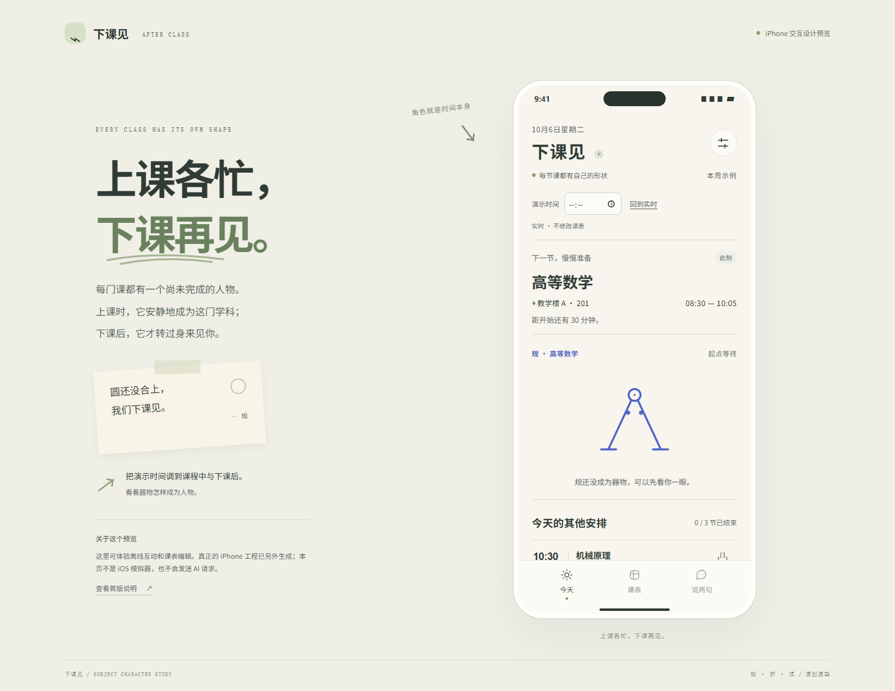
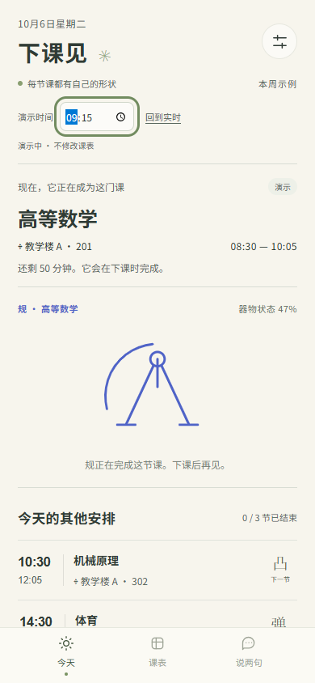
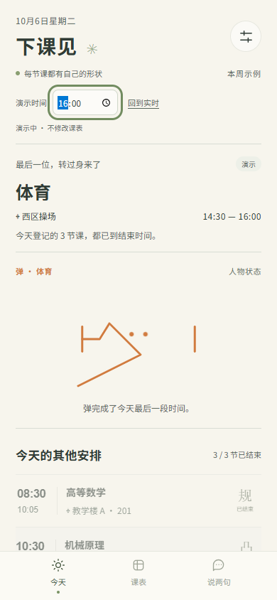

# 下课见 · After Class

每门课都有一个自己的角色。上课时它安静地成为学科器物，下课后才转过身来见你；AI 也用当天角色的口吻回应。



| 上课中的「规」 | 下课后的「弹」 |
|---|---|
|  |  |

## 2026-10-12 角色设计

- 删除全局小幽灵、心情按钮和“课间小屋”，让课程角色成为唯一主角。
- 高数「规」、工程制图「折」、英语「逗」、机械「凸」、体育「弹」、实验「试」各有原创线条造型；其他课程使用可辨认的「未」角色。
- 角色本身就是进度：课程期间隐藏眼睛、以器物形态随时间完成；课外恢复眼睛与轻触回应。页面不会把角色当作签到证据，也不推断真实出勤。
- AI 上下文加入当前课程、角色与器物／人物状态；聊天保留明确的离线回应标记。
- 原生 SwiftUI 与浏览器预览已同步。浏览器通过 22 项检查；原生通过静态语法／工程检查，仍未编译与真机运行。

## 现在能看什么

本机设计预览：**http://127.0.0.1:4178**。可调整演示时间，观察角色从人物变为器物、随课堂推进，再在下课后转身；也包含离线聊天、星期切换和课程增删改。预览数据保存在浏览器。它是单独制作的交互预览，不是原生 App 或 iOS 模拟器。预览不收集 API 密钥，不发送真实 AI 请求。

预览服务停止后，在此目录运行 `node preview/server.cjs`。服务仅绑定本机回环地址。

## 原生工程

打开 `AfterClass.xcodeproj`，选择 `AfterClass` scheme。目标为 iOS 18+，SwiftUI，iPhone 竖屏。工程已包含共享 scheme、XCTest 测试和固定上游提交的 Swift Package 依赖；不需要 XcodeGen。

已实现源码：

- 今日课程、课程时间状态、星期切换、学期周次和单双周选择。
- 新增、编辑、删除课程；检测重叠并同时保留展示；示例课表有明确标注。
- 使用 HorizonCalendar 的原生日期选择；JSON 课表导入前预览并确认替换、导出课表备份。
- 原创学科角色、时间进度形变、课外轻触回应；响应系统减少动态效果设置。
- 离线互动、真实 AI 接口实现；AI 取得当前角色状态，聊天本机保存并支持清空。
- 手动可编辑的记忆、学期日期和 AI 配置。
- API 密钥保存在设备钥匙串，不进入 JSON、源码或浏览器预览。

AI 配置在原生 App 的「今天 → 设置」中填写：HTTPS Base URL（例如服务商提供的 `/v1` 地址）、模型标识、API Key，然后启用 AI。接口使用 OpenAI 兼容的 `POST /chat/completions`。模型需遵循 JSON 输出提示；不符合输出契约时显示错误，不假装成功。开启后会向用户配置的服务发送最近 16 条对话、当天课程标题和时间、用户填写的记忆，可能产生服务商费用。未配置时明确显示离线回应。

首版没有教务系统登录、图片课表识别、语音、桌面小组件、推送提醒、账户同步或 App Store 分发。课表 JSON 不是完整聊天备份；卸载前请留意设备内的数据。

## 没有 Mac 的当前状态

本次是在 Windows 上制作。**未运行 Xcode 编译、iOS 模拟器或 iPhone 真机；未接入用户的真实 AI 服务。** 源码语法检查和工程引用检查不能代替 Swift 类型检查或实际运行。

有 Mac 后：使用 Xcode 16.3 或更新版本，等待依赖解析完成，选择 iPhone 模拟器运行。安装到自己的 iPhone 时，在 Signing & Capabilities 中选择自己的 Team，并使用可用的 Bundle ID。签名信息没有预填。

仓库附带 `.github/workflows/ios.yml`，可在用户将项目放进自己的 GitHub 仓库后运行 macOS 构建和测试。本次没有创建或上传 GitHub 仓库，没有执行该工作流。

Mac 本地验证命令（设备名称按实际模拟器替换）：

```sh
xcodebuild -project AfterClass.xcodeproj -scheme AfterClass -destination 'platform=iOS Simulator,name=iPhone 16' CODE_SIGNING_ALLOWED=NO test
```

## 实际复用

| 上游 | 使用位置 | 许可证 |
|---|---|---|
| [HorizonCalendar](https://github.com/airbnb/HorizonCalendar) | `CalendarSheet` 中直接调用 `CalendarViewRepresentable` | Apache-2.0 |
| [AIRI](https://github.com/moeru-ai/airi) | 仅借鉴对话与角色状态联动，不含其代码或角色素材 | 参考项目 |

完整许可证位于 `ThirdParty/`，并打包进原生 App 的致谢页。固定提交详见 `ThirdParty/SOURCES.md`。由于已经选择原生 iOS，React/Motion/Y2K UI 没有被加入 App。

## 项目结构与检查

- `App/`：原生 Swift 源码。
- `Tests/`：课程边界、周次、冲突、持久化、AI 输出与地址、导入验证的 XCTest。
- `preview/`：独立浏览器交互预览，无 npm 依赖。
- `scripts/generate_project.py`：生成已提交的 Xcode 工程。
- `scripts/validate_source.py`：Swift 语法树、Xcode 工程引用和许可证检查。
- `scripts/check_preview.cjs`：Playwright 浏览器交互检查。
- `VALIDATION.md`：本次实测结果与未验证项。

Python 检查依赖：`tree-sitter tree-sitter-swift openstep-parser`。Playwright 检查使用 `playwright` 和已安装的 Chrome/Edge，浏览器通道可以用 `AFTERCLASS_BROWSER_CHANNEL` 配置。

原生字体采用系统圆角字体，颜色为奶油白、鼠尾草绿、浅杏和淡紫。浏览器预览使用本地系统字体，不依赖外部字体服务。
